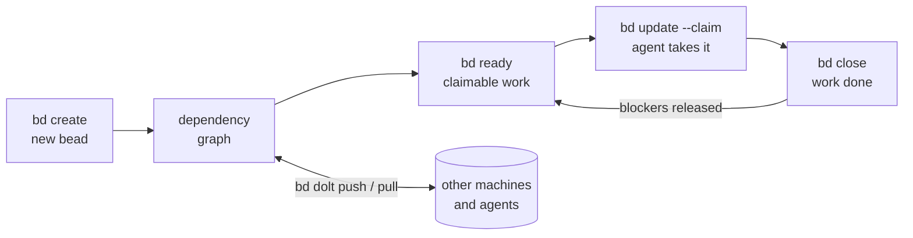

# bd - Beads

**Distributed graph issue tracker for AI agents, powered by [Dolt](https://github.com/dolthub/dolt).**

**Platforms:** macOS, Linux, Windows, FreeBSD

[](LICENSE)
[](https://goreportcard.com/report/github.com/steveyegge/beads)
[](https://github.com/gastownhall/beads/releases)
[](https://www.npmjs.com/package/@beads/bd)
[](https://pypi.org/project/beads-mcp/)

**Docs:** https://beads.gascity.com/

Beads provides a persistent, structured memory for coding agents. It replaces messy markdown plans with a dependency-aware graph, allowing agents to handle long-horizon tasks without losing context.



## ⚡ Quick Start

```bash
# Install beads CLI (system-wide - don't clone this repo into your project)
curl -fsSL https://raw.githubusercontent.com/gastownhall/beads/main/scripts/install.sh | bash

# Initialize in YOUR project
cd your-project
bd init

# Optional: refresh or install richer instructions for your agent
bd setup codex    # Codex CLI - installs skill, AGENTS.md guidance, and hooks
bd setup claude   # Claude Code - installs hooks/settings
bd setup factory  # Factory.ai Droid - creates/updates AGENTS.md
```

**Note:** Beads is a CLI tool you install once and use everywhere. You don't need to clone this repository into your project.

`bd init` creates or updates `AGENTS.md` by default so agents can discover the beads workflow, and also installs the project Claude Code, Codex, and Cursor integrations unless you pass `--skip-agents` or `--stealth`. Use `bd setup --list` to see supported integrations, including `bd setup codex`, `bd setup factory`, `bd setup claude`, `bd setup mux`, `bd setup cursor`, and more. See [Agent and IDE setup](docs/getting-started/ide-setup.md).

Manual copy-paste is only for unsupported agents, existing projects where you cannot rerun `bd init`/`bd setup`, or custom instruction files. In those cases, run `bd onboard` and paste the printed snippet into the file your agent reads.

If your agent is not covered by `bd setup`, add this minimal `AGENTS.md` section:

```markdown
This project uses bd (beads) for issue tracking.

- Run `bd prime` for workflow context and command guidance.
- Use `bd ready`, `bd show <id>`, `bd update <id> --claim`, and `bd close <id>`.
- Use `bd remember "insight"` for durable project facts; keep per-operator preferences in your harness's own memory.
- Do not use markdown TODO lists for task tracking.
```

## 🛠 Features

* **[Dolt](https://github.com/dolthub/dolt)-Powered:** Version-controlled SQL database with cell-level merge, native branching, and built-in sync via Dolt remotes.
* **Agent-Optimized:** JSON output, dependency tracking, and auto-ready task detection.
* **Zero Conflict:** Hash-based IDs (`bd-a1b2`) prevent merge collisions in multi-agent/multi-branch workflows.
* **Compaction:** Semantic "memory decay" summarizes old closed tasks to save context window.
* **Messaging:** Message issue type with threading (`--thread`), ephemeral lifecycle, and mail delegation.
* **Graph Links:** `relates-to`, `duplicates`, `supersedes`, and `replies-to` for knowledge graphs.

## 📖 Essential Commands

| Command | Action |
| --- | --- |
| `bd ready` | List tasks with no open blockers. |
| `bd create "Title" -p 0` | Create a P0 task. |
| `bd update <id> --claim` | Atomically claim a task (sets assignee + in_progress). |
| `bd dep add <child> <parent>` | Link tasks (blocks, related, parent-child). |
| `bd show <id>` | View task details and audit trail. |
| `bd prime` | Print agent workflow context and persistent memories. |
| `bd remember "insight"` | Store project memory that `bd prime` injects later. |

## 🔗 Hierarchy & Workflow

Beads supports hierarchical IDs for epics:

* `bd-a3f8` (Epic)
* `bd-a3f8.1` (Task)
* `bd-a3f8.1.1` (Sub-task)

**Stealth Mode:** Run `bd init --stealth` to use Beads locally without committing files to the main repo. Perfect for personal use on shared projects. See [Git-Free Usage](#-git-free-usage) below.

**Contributor vs Maintainer:** When working on open-source projects:

* **Contributors** (forked repos): Run `bd init --contributor` to route planning issues to a separate repo (e.g., `~/.beads-planning`). Keeps experimental work out of PRs.
* **Maintainers** (write access): Beads auto-detects maintainer role via SSH URLs or HTTPS with credentials. Only need `git config beads.role maintainer` if using GitHub HTTPS without credentials but you have write access.
* Outside Git, Beads discovers `.beads` in parent directories, follows a shared-store symlink, and reads `beads.role` from the store repository’s local Git config. Set it with `git -C /path/to/store-repo config --local beads.role maintainer` (or `contributor`). Inside Git, the current repository’s configuration still takes precedence.

## 📦 Installation

```bash
brew install beads           # macOS / Linux (recommended)
npm install -g @beads/bd     # Node.js users
```

**Other methods:** [install script](docs/getting-started/installation.md#quick-install-script-all-platforms) | [go install](docs/getting-started/installation.md#a-note-on-go-install-capability) | [from source](docs/getting-started/installation.md#build-dependencies-contributors-only) | [Windows](docs/getting-started/installation.md#windows-11) | [Arch AUR](docs/getting-started/installation.md#linux)

**Requirements:** macOS, Linux, Windows, or FreeBSD. See [docs/getting-started/installation.md](docs/getting-started/installation.md) for complete installation guide.

**Upgrading?** Replacing the binary is not always the whole story. Short
version: sync remote-backed databases with your current `bd`, back up with
`bd export --all`, upgrade the binary, then run `bd info --whats-new`,
`bd hooks install`, and `bd version`. If the upgrade crosses a schema
migration on a remote-backed database, exactly one designated clone runs
`bd migrate schema` and `bd dolt push`; other clones install the new
binary and run `bd bootstrap`. See the full
[upgrade guide](https://beads.gascity.com/getting-started/upgrading)
or [docs/getting-started/installation.md](docs/getting-started/installation.md#updating-bd).

### Security And Verification

Before trusting any downloaded binary, verify its checksum against the release `checksums.txt`.

The install scripts verify release checksums before install. For manual installs, do this verification yourself before first run.

On macOS, `scripts/install.sh` preserves the downloaded signature by default. Local ad-hoc re-signing is explicit opt-in via `BEADS_INSTALL_RESIGN_MACOS=1`.

See [docs/reference/antivirus.md](docs/reference/antivirus.md) for Windows AV false-positive guidance and verification workflow.

## 💾 Storage Modes

Beads uses [Dolt](https://github.com/dolthub/dolt) as its database. Two modes:

- **Embedded (default)** — `bd init`. Dolt runs in-process, data lives in
  `.beads/embeddeddolt/`, single writer. Recommended for most users.
- **Server** — `bd init --server`. Connects to an external `dolt sql-server`
  for multiple concurrent writers; data lives in `.beads/dolt/`.

Cross-machine sync uses `bd dolt push` / `bd dolt pull` against
`refs/dolt/data` on your git remote; `.beads/issues.jsonl` is an export for
viewers and interchange, not the source of truth or a backup. Back up and
migrate between modes with `bd backup`; reclaim space with `bd prune` /
`bd purge`.

Full detail — connection flags, sockets, maintenance, backup, and migration —
in the [Dolt backend guide](docs/architecture/dolt.md).

### Schema Version Guard

`bd` checks the database schema version at open time. If the database has been
migrated by a newer binary and an older binary tries to open it, `bd` exits
with an actionable error rather than issuing queries that fail with cryptic SQL
errors:

````
schema version mismatch: database is at v45, binary knows up to v42 (3 migrations ahead)

  Your bd binary is stale. Queries for dropped or renamed columns will fail
  with cryptic SQL errors (e.g. "column X could not be found in any table in scope").

  Rebuild from main:
    CGO_ENABLED=0 go build -tags gms_pure_go ./cmd/bd

  Or install the latest release:
    CGO_ENABLED=0 go install -tags gms_pure_go github.com/steveyegge/beads/cmd/bd@latest

  To proceed despite the risk (some read commands may still work):
    BD_IGNORE_SCHEMA_SKEW=1 bd <command>
    bd --ignore-schema-skew <command>
````

**When this fires:** only when the database schema is *ahead* of the binary
(a newer binary migrated the database; this binary doesn't know those
migrations). Normal upgrades, where the binary migrates the database forward,
are unaffected.

**Escape hatch:** `BD_IGNORE_SCHEMA_SKEW=1` (or `--ignore-schema-skew`) bypasses
the guard with a warning on stderr. Use this only if you know the forward
migrations are additive and safe for your specific workload.

## 🔌 HTTP Backend (experimental)

A workspace can also talk to a remote `bd serve` over HTTP instead of opening
a local Dolt database — useful for a thin client against a shared server, or
for embedding beads in another program as a library.

```bash
# Point this workspace at a server (verifies the server first; writes nothing on failure)
bd connect https://bd.example.com --expect-project-id my-project

# The everyday commands work the same way: create, show, list, update, close,
# dependencies (including `bd dep tree`), comments, ready/count queries, and
# batch apply all round-trip over the wire with the same semantics as a local
# database. So does `bd ready --claim`, except against an older server or while
# any issue holds an unsatisfied external ref: then it lists and claims in two
# steps rather than one transaction (ledger row L14, linked below).
bd create "Fix auth bug" -p 1 -t bug
bd ready --json
bd close bd-a1b2 "Fixed"

# Loopback needs no TLS
bd connect http://127.0.0.1:8080

# Forget the server and restore this workspace's previous backend selection
bd connect --clear
```

HTTP mode is not a byte-for-byte mirror of local mode, though: some
operations are knowingly refused (the wire has no way to express them) or
degrade to a different-but-not-misreadable behavior (for example, a few
unbounded listing shapes lose single-query snapshot isolation and instead
walk the server page by page). Every one of these is a deliberate, tested
row, never a silent gap — see
[`engdocs/design/http-divergence-ledger.md`](engdocs/design/http-divergence-ledger.md)
for the full, generated list of what differs and why before depending on an
HTTP-backed workspace for a workflow you haven't checked against it. One
refusal to know up front: `bd close --claim-next` closes nothing over HTTP,
because the wire's batch close cannot carry the claim. Close without it, then
run `bd ready --claim`.

[Cross-repo dependencies](docs/core-concepts/dependencies.md#cross-repo-dependencies)
keep their policy over HTTP. The client resolves each `external:` reference
against its own `external_projects` configuration. `bd dep tree` shows the
reference as a leaf, and while it is unsatisfied the issue stays out of
`bd ready` and `bd ready --claim`, and `bd close` refuses it without
`--force`. A server that advertises enforcing that policy itself is trusted
to do so instead.

Three CLI-level differences are worth knowing up front:

- IDs resolve exactly: an abbreviated id is not expanded (the wire has no
  substring search), and a missing id is reported as not found after one
  lookup.
- `bd update -s closed` does not record `closed_by_session` (from `--session`
  or `CLAUDE_SESSION_ID`), because the wire's update cannot carry it; the
  close itself happens as usual. `bd close` does record the session. `bd
  reopen`'s history entry carries the server's own label.
- Contributor auto-routing (`routing.*` settings) is read from local
  `config.yaml` / environment only, never from the server's settings: its
  targets are local paths.

`bd connect` writes two things on success: `.beads/metadata.json` gets
`"backend": "http"`, and a per-user, never-git-tracked sidecar
(`.beads/http_target.json`) records the server URL and pinned project id. It
never writes a credential to disk. A bearer credential, if the server
requires one, comes from `BEADS_HTTP_TOKEN=host[:port]=<token>`, then
`BEADS_HTTP_TOKEN_COMMAND=host[:port]=<command>` (a helper that prints a
token), then the credentials file, then no credential at all. Both variables
must name the server they are for (a pattern without a port matches that
host on any port); a bare value is refused, because it would be sent to
whatever server the workspace's `http_target.json` names. Connecting to a
non-loopback server over plain `http://` is refused by default (a bearer
credential would cross the network unencrypted) — pass `--allow-plaintext` to
override, or use `https://`. Switching a workspace that already selects a
different backend needs `--force`.

Each read (a GET, or the POST batch get) gives its first attempt 15s, from
when the request is sent, to get the server's response headers
(`BEADS_HTTP_RESPONSE_HEADER_TIMEOUT`: a duration such as `30s`, a number of
seconds, or `off`). A read whose headers do not arrive in time, or whose
connection is reset, is retried once on another connection, and each retry
is logged to stderr with its count. The retry has no header timer, but it
runs on what is left of the 60s bound on the whole request, counted from
when the first attempt was sent: a slow but healthy read still finishes if
the retry's headers and body together fit in that remainder (about 45s after
a header timeout), and one that needs longer now fails at 60s. The header
timer never cuts off a body that is still streaming; the 60s bound still
does. The events:watch stream's connect gets neither the header timer nor
the retry. On Windows a reset connection is retried only when it surfaces as
an early EOF, because the check matches the Unix reset error (`ECONNRESET`),
which a Windows reset (`WSAECONNRESET`) is not. A write gets no
header timer (the server answers a write only after it commits, so a large
one can be slow and healthy) and is never retried; if the 60s bound expires
after it was sent but before its headers, it fails with an error naming the
server's host, because it may or may not have been applied. A batch apply of
more than 100 items (a large `bd create --graph` plan, say) gets 6 minutes
instead of 60s, because `bd serve` gives such a request its
`--large-apply-ceiling` (5 minutes by default) and finishes it even after the
client has given up. A server whose ceiling is raised past about 5m15s can
still outlast the client. A dial or TLS timeout stays a plain connection
error, since the server never saw the request, and a connect that fails says
so: it names the address that refused the connection (nothing listening) or
never answered (a filtered port or a down host, after the dialer's 30s), or
the host name that did not resolve. `off` turns off only the
header timer: a reset read is still retried, and a write's timeout is still
reported as above.

Whether the server applies bd's external-dependency policy itself (the
`policy.external_dependencies` capability) is remembered for 5 minutes per
server URL and pinned project, in `beads/http-policy/` under the user cache
directory, so `bd ready` does not fetch the server's context before every
listing just to learn it. `BEADS_HTTP_POLICY_CACHE_TTL` sets that window (a
duration such as `1m`, a number of seconds, or `off`); a server restarted
with a different composition is seen once it passes. Claims and closes never
use the cached answer: they ask the server, since a stale one could skip the
client-side refusal of externally blocked work. A workspace connected without
a project pin is not cached.

`bd search`, `bd show --current` and `bd recompute-blocked` work over HTTP
too, each in its own way. `bd search` asks the server's listing with its text (`q`, behind the `issues.list.search` capability) and
refuses before dialing against a server that does not advertise it. `bd list
--no-assignee`, `--title` and `--id` likewise ride the listing's
`no_assignee`, `title` and repeatable `id`, each behind its own capability
(`issues.list.noAssignee`, `issues.list.title`, `issues.list.ids`), and the
rest of `bd list`'s filters (`--updated-*`, `--closed-*`, `--defer-*`,
`--due-*`, `--priority*`, the text and external-ref matches, `--spec`,
`--label-pattern`/`--label-regex`, `--exclude-type`, `--no-parent`,
`--no-labels`, `--empty-description`, `--pinned`/`--no-pinned`,
`--deferred`, `--overdue`, `--mol-type`, `--wisp-type`) ride it behind one
capability, `issues.list.filters`. Time bounds are resolved on the client as
they are locally; `--overdue` compares against the server's clock. The
default `--parent` tree view does not carry those filters yet and refuses one
rather than drop it; `--flat` or `--json` applies them to the parent's direct
children (not its whole subtree).
`bd show --current` finds the actor's in-progress or hooked issue through the
server's boolean query. `bd recompute-blocked` is a no-op that exits 0: the
server maintains `is_blocked` on every write, and repairing a stale flag is
done in the server's own workspace (`--json` reports
`{"rows_corrected": 0, "maintained_by": "server"}`).

An embedding program that links beads as a library rather than running
`cmd/bd` registers this backend itself through the public
[`backend/http`](backend/http) package (`bdhttp.Register`), and can open a
workspace with a credential scoped to one caller via
`beads.OpenBestAvailableWith` — see that package's doc comment for the
multi-tenant case. This surface is EXPERIMENTAL: pin an exact beads version.

## 🌐 Community Tools

See [docs/community-tools.md](docs/community-tools.md) for a curated list of community-built UIs, extensions, and integrations—including terminal interfaces, web UIs, editor extensions, and native apps.

See [docs/related-projects.md](docs/related-projects.md) for adjacent or complementary projects that solve different problems in the same neighborhood.

## 🚀 Git-Free Usage

Beads works without git. The Dolt database is the storage backend — git
integration (hooks, repo discovery, identity) is optional.

```bash
# Initialize without git
export BEADS_DIR=/path/to/your/project/.beads
bd init --quiet --stealth

# All core commands work with zero git calls
bd create "Fix auth bug" -p 1 -t bug
bd ready --json
bd update bd-a1b2 --claim
bd prime
bd close bd-a1b2 "Fixed"
```

`BEADS_DIR` tells bd where to put the `.beads/` database directory,
bypassing git repo discovery. `--stealth` sets `no-git-ops: true` in
config, disabling bd's own git hook installation and git commands. It
does not stop Dolt network sync; set `dolt.local-only: true` for that.

This is useful for:
- **Non-git VCS** (Sapling, Jujutsu, Piper) — no `.git/` directory needed
- **Monorepos** — point `BEADS_DIR` at a specific subdirectory
- **CI/CD** — isolated task tracking without repo-level side effects
- **Evaluation/testing** — ephemeral databases in `/tmp`

## 📝 Documentation

* [Documentation site](https://beads.gascity.com/) | [Installing](docs/getting-started/installation.md) | [Sync Concepts](docs/core-concepts/sync-concepts.md) | [Agent Setup](docs/getting-started/ide-setup.md) | [Copilot CLI Setup](docs/integrations/copilot-cli.md) | [Copilot VS Code MCP](docs/integrations/github-copilot.md) | [Articles](ARTICLES.md) | [Sync Branch Mode](docs/reference/protected-branches.md) | [Troubleshooting](docs/reference/troubleshooting.md) | [FAQ](docs/reference/faq.md)
* Contributing: [CONTRIBUTING.md](CONTRIBUTING.md) (Bazel builds and tests beads: install [Bazelisk](https://github.com/bazelbuild/bazelisk), then `make test`) | [Roadmap](ROADMAP.md) | [Contributor agent instructions](AGENTS.md)
* [](https://deepwiki.com/gastownhall/beads)
